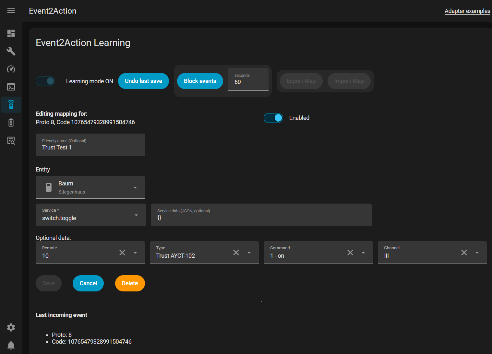

# Event2Action

### Learn and map any button or event to Home Assistant actions

Event2Action is the missing **button-learning layer for Home Assistant**. Use its visual learning interface to map **RF433 and IR remotes, Zigbee buttons, MQTT and ESPHome events**, or virtually any other Home Assistant event to actions—without creating a separate automation for every button.



- ✅ Reuse old RF433 and IR remotes
- ✅ Map Zigbee buttons and scene switches
- ✅ Connect MQTT, ESPHome, and custom events
- ✅ Control lights, plugs, scenes, scripts, and automations
- ✅ Keep everything local, with no cloud dependency

> **Current status:** Event2Action is stable in my daily Home Assistant installation and has been running reliably for several months. The configuration UI and setup process are still evolving, so feedback and issue reports are welcome.

## Supported Event Sources

| Event source | Support |
|---|---|
| RF433 via ESPHome | ✅ Adapter included |
| Zigbee via ZHA | ✅ Adapter included |
| Zigbee2MQTT | Easy custom adapter |
| MQTT events | Easy custom adapter |
| ESPHome custom events | Easy custom adapter |
| IR receivers | Easy custom adapter |
| Any Home Assistant event | Supported through an event adapter |

An **event adapter** is a simple Home Assistant automation that converts a source event into Event2Action's normalized format. The included adapters listen for `esphome.rf433` and `zha_event`; they provide practical examples for connecting other sources.

## Why Event2Action?

- **Reuse existing remotes (RF433, IR etc)** from Intertechno, Elro, Brennenstuhl, A-Trust, and similar systems to control modern Home Assistant devices
- **Keep familiar physical controls** for household members who prefer old-school remotes over apps, dashboards, or voice control
- **Turn simple remote buttons into generic Home Assistant triggers** for lights, plugs, scenes, scripts, and automations
- **Works locally** with no cloud dependency once Home Assistant and your event source are running
- **One button, multiple possibilities**: trigger scenes, scripts, or complex automations from a single press
- **One central automation flow** handles incoming events through normalized event adapters
- **Cost-effective**: repurpose existing remotes instead of buying new smart buttons

## Map a Button in 30 Seconds

1. Enable learning mode.
2. Press a button or fire an event.
3. Select a Home Assistant entity and action.
4. Save the mapping.
5. Press the button again—done.

## Documentation

- **[QUICKSTART.md](QUICKSTART.md)** - Minimal setup path
- **[e2a-mapping-editor-reference.md](e2a-mapping-editor-reference.md)** - Detailed editor features and usage

## Features

- **Event2Action runtime**: one central bus handler executes mapped Home Assistant actions
- **RF433 event adapter**: normalizes `esphome.rf433` events into the shared `event2action_bus`
- **ZHA event adapter**: normalizes `zha_event` button payloads into the same bus
- **Learning mode**: interactively learn and map incoming event codes
- **Visual editor**: create and edit mappings without hand-editing JSON
- **Friendly names**: optionally assign a unique human-readable name to a mapping for organization and future functionality
- **Backup and undo**: session and step-level backups
- **Import/export**: save and restore mappings as JSON
- **Event blocking**: temporarily suppress action execution while learning
- **MQTT storage**: publish runtime maps and backups through Home Assistant MQTT sensors

## How It Works

Event adapters translate source-specific payloads into a stable protocol/code pair and fire the shared `event2action_bus` event. The learning card captures that normalized event and stores its action mapping. The central bus handler then executes the mapped Home Assistant action whenever the event occurs again.

For example, `event2action_zha_feeder` uses `ZHA` as the protocol and derives a distinctive code from the device's full IEEE address, endpoint, and command (such as press, double press, or long press). Use it as a template for IR receivers, MQTT devices, NFC scans, doorbells, BLE buttons, or other event sources.

## Requirements

- Home Assistant 2024.1 or newer
- MQTT Broker, such as Mosquitto
- Modern web browser for the Lovelace card
- At least one event source:
  - RF433 source that fires Home Assistant events named `esphome.rf433`
  - Zigbee devices using ZHA, which emit `zha_event`

## Installation

### 1. Home Assistant Package

HACS installs the Lovelace card only. It does not copy the Home Assistant package into your config directory.

From the Home Assistant Terminal/SSH add-on, download the package file into `/config/packages/`:

```bash
mkdir -p /config/packages
wget -O /config/packages/event2action.yaml https://raw.githubusercontent.com/Dschuli/ha-event2action/main/packages/event2action.yaml
```

If your terminal does not have `wget`, use `curl` instead:

```bash
mkdir -p /config/packages
curl -L -o /config/packages/event2action.yaml https://raw.githubusercontent.com/Dschuli/ha-event2action/main/packages/event2action.yaml
```

Make sure package loading is enabled in `configuration.yaml`:

```yaml
homeassistant:
  packages: !include_dir_named packages
```

If you already have a `homeassistant:` section, add only the `packages:` line under it. Restart Home Assistant after adding the package or changing `configuration.yaml`.

### 2. Automations

The package contains three automations. The two adapter automation names retain the legacy term `Feeder` for compatibility:

- `Event2Action RF433 Feeder`: RF433 event adapter that listens for `esphome.rf433`
- `Event2Action ZHA Feeder`: ZHA event adapter that listens for `zha_event`
- `Event2Action Bus Handler`: stores the latest normalized event and runs mapped actions

It also creates the required MQTT sensors, helper entities, and helper script used by the card.

### 3. Dashboard Card

Add the card resource:

```yaml
url: /hacsfiles/ha-event2action/event2action-learning-card.js
type: module
```

Then add the Lovelace card:

```yaml
type: custom:event2action-learning-card
```

Use this card in a dedicated panel view. A panel subview is also a good option if you want to keep Event2Action out of the normal dashboard tab list. `mdi:remote` works well as the view icon.

## Event Source Expectations

### RF433

The RF433 event adapter expects events named `esphome.rf433` with data similar to:

```json
{
  "protocol": 1,
  "code": "1234567",
  "command": "A"
}
```

`protocol` may also be provided as `proto`. The adapter normalizes these fields into `device_ieee`, `proto`, `code`, `command`, `source`, and `origin_event_type`.

### ZHA

The ZHA event adapter listens for `zha_event` and derives a stable code from the full device IEEE address (with `:` or `-` separators removed), endpoint, and command. It supports short, double, and long press style commands. Because this format replaces the earlier shortened IEEE suffix, existing ZHA mappings created with the old format must be migrated or learned again.

### Migrating from v0.1.3-beta

Use the standalone migration tool for existing v0.1.3-beta maps. See [migration/README.md](migration/README.md) for the procedure. The migration utility is separate from the card UI and produces a new JSON file for review and import.

## Usage

1. Enable learning mode in the Event2Action card.
2. Press a button or fire a test event.
3. Optionally enter a unique Friendly name, intended to support future functionality enhancements.
4. Pick the target entity and service.
5. Save the mapping.
6. Disable learning mode and test the button.

For detailed editor behavior, backup/restore, import/export, and service data examples, see [e2a-mapping-editor-reference.md](e2a-mapping-editor-reference.md).

### Optional Script Targets

Event2Action can call any Home Assistant script. For example, the RF433 sniffer project [`Dschuli/rf433-esphome-sniffer`](https://github.com/Dschuli/rf433-esphome-sniffer) includes dimmer-control support that can provide a `script.dimmer_control` service target for handheld remote dimming. In that setup, map a learned button to `script.turn_on`, target `script.dimmer_control`, and pass service data such as:

```json
{
  "light_entity": "light.living_room",
  "steps": 5,
  "bounce_at_top": false
}
```

That script is not bundled here; this repository only stores and executes the mapping.

## Testing Without Hardware

Open Home Assistant Developer Tools -> Events and fire an `esphome.rf433` event:

```json
{
  "protocol": 1,
  "code": "111111111",
  "command": "test"
}
```

This exercises the RF433 event adapter and the shared runtime flow without requiring a physical RF source.

## Configuration

Open the dashboard card configuration editor to customize the user-facing options:

- Supported entity domains
- Custom common service data dropdown entries
- Prefilled service data by entity/service pattern for custom entities, e.g. scripts
- Auto-unblock behavior
- Logging level

Example YAML:

```yaml
type: custom:event2action-learning-card
entity_domain_list:
  - switch
  - light
  - cover
  - script
  - automation
auto_unblock: true
log_level: 2
custom_common_service_data_keys:
  "*dimmer_control|script.turn_on":
    - label: light_entity
      value: light_entity
      default: ""
prefill_service_data:
  "*dimmer_control|script.turn_on": '{"light_entity":" ","steps":5,"bounce_at_top":false}'
```

MQTT sensor names, MQTT topics, and helper entity names remain code-level defaults in `src/e2a-config.js`; most installations should not need to change them.

## Troubleshooting

### No Events Appear

1. In Developer Tools -> Events, listen for `event2action_bus`.
2. Fire or trigger an `esphome.rf433` or `zha_event`.
3. Verify `/config/packages/event2action.yaml` is installed and Home Assistant was restarted.
4. Check that `input_text.event2action_last_event_store` is updated.

### Learning Mode Not Working

1. Verify the required helper entities exist.
2. Verify the MQTT sensors from `packages/event2action.yaml` are present.
3. Check browser console output for card errors.
4. Clear the browser cache after frontend file changes.

### Mappings Not Executing

1. Verify `sensor.event2action_runtime_map` contains a map attribute.
2. Confirm `input_boolean.event2action_block_events` is off.
3. Check the target entity and service still exist.
4. Review the automation trace for `Event2Action Bus Handler`.

## Project Structure

```text
ha-event2action/
├── dist/
│   └── event2action-learning-card.js  # Built Lovelace card loaded by HACS/Home Assistant
├── packages/
│   └── event2action.yaml              # Home Assistant package: helpers, MQTT sensors, scripts, automations
├── migration/
│   ├── migrate-v0.1.3-to-v0.2.0.js    # Standalone mapping migration utility
│   └── README.md                       # Migration procedure and safety notes
├── src/
│   ├── e2a-learning-card.js           # Main learning card
│   ├── e2a-editor.js                  # Mapping editor UI
│   ├── e2a-card-editor.js             # Lovelace card config editor
│   ├── e2a-config.js                  # Default domains, topics, helpers, editor defaults
│   ├── mixins/                        # Shared card mixins
│   ├── styles/                        # Shared Lit CSS modules
│   └── utils/                         # Utility helpers
├── pictures/                          # README / documentation images
├── hacs.json                          # HACS plugin metadata
├── vite.config.js                     # Build config
├── QUICKSTART.md
└── README.md
```
## Acknowledgments

- Home Assistant community for inspiration and support
- All contributors and users of this project
- AI-assisted tools were used to support the coding, documentation, and review process. All resulting changes were reviewed and tested by the project maintainer.

## License

This project is open source and available under the MIT License.
