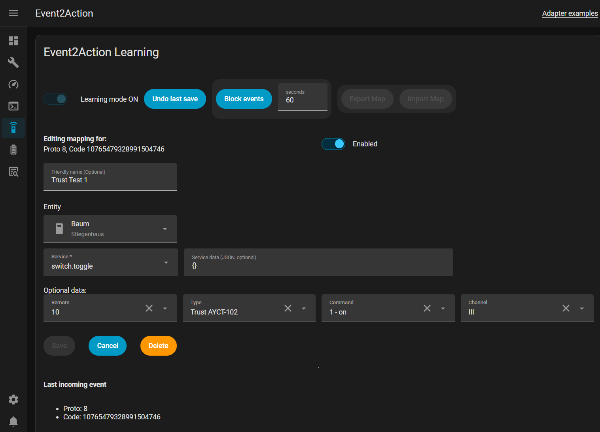
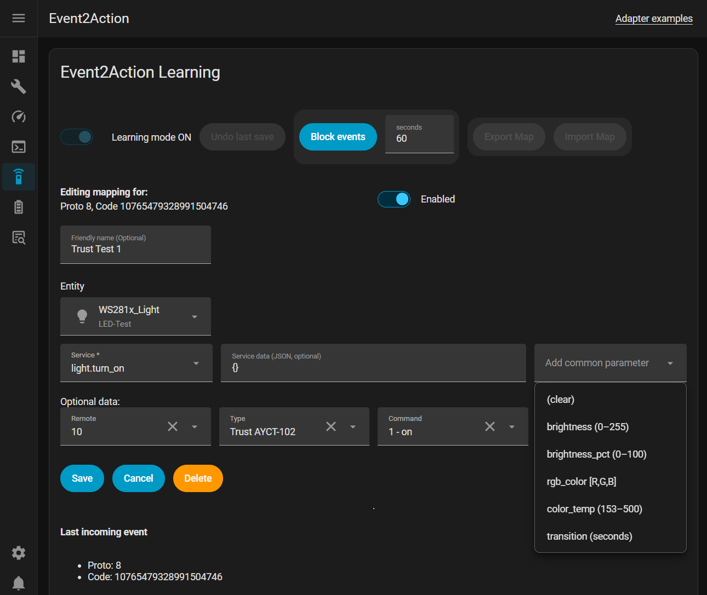
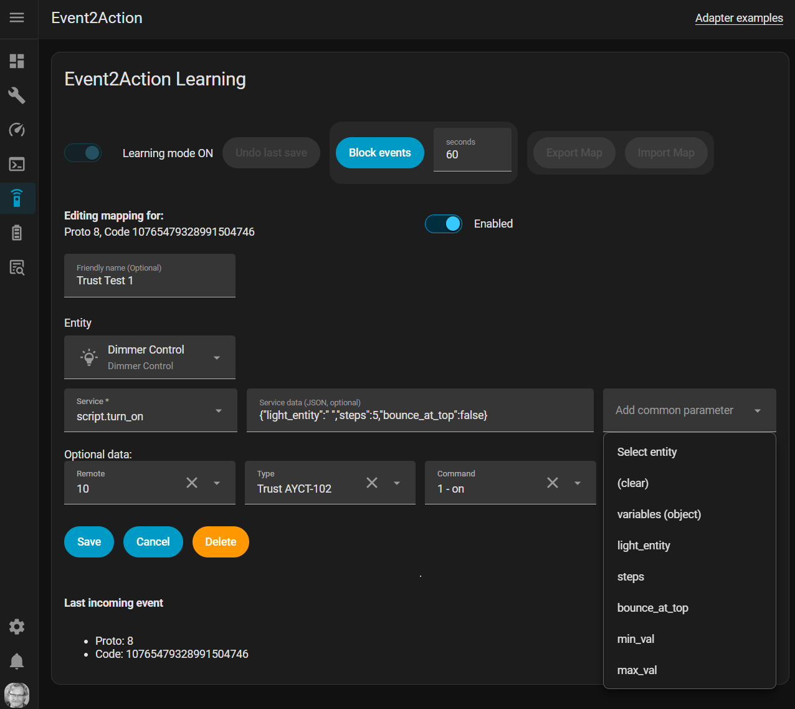
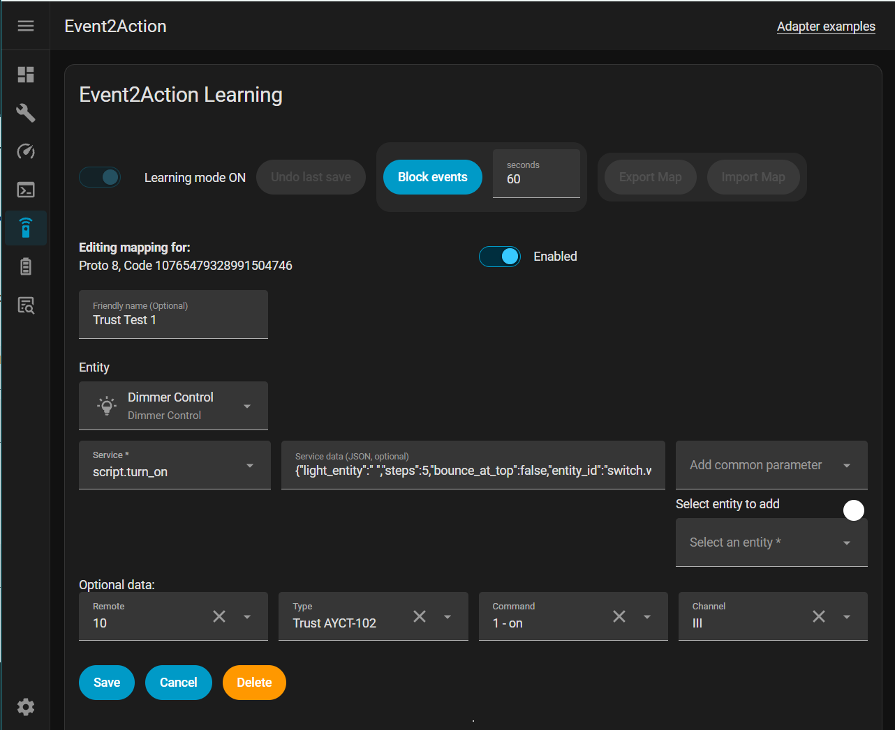

# Learning Card and mapping editor

Use this reference while configuring mappings and card options. Installation is covered in the [quick start](QUICKSTART.md), and source-specific setup is in the [adapter examples](examples/adapters/EXAMPLES_README.md).

## Create or edit a mapping

1. Enable **Learning mode**. A backup is captured before the session begins.
2. Press the button you want to map. The editor opens with its protocol and code, or with its existing mapping.
3. Choose the **Entity** and **Service**, add any service data, and select **Save**.
4. Turn learning off and test the button with events unblocked.

Use **Block events** during configuration if existing mappings could trigger unwanted actions. Learning continues while actions are blocked.



To edit an existing mapping, enable learning and press its button again. While the editor is open, it stays on that mapping. **Cancel** discards the draft; **Delete** removes an existing mapping after confirmation. **Save** becomes available when fields change.

### Mapping fields

| Field | Use |
| --- | --- |
| Enabled | Switch the mapping on or off. Disable it to retain an incomplete mapping for later. |
| Friendly name | Optional mapping name, displayed in the card. Names must be unique, ignoring letter case. |
| Entity | Target entity, filtered by the domains configured for the card. |
| Service | Action to call, such as `light.turn_on` or `cover.set_cover_position`. The list follows the entity's domain and accepts custom values. |
| Service data | Optional JSON object with action parameters. |
| Remote, Type, Command, Channel | Optional labels for organizing and recognizing mappings. Existing values are suggested. Command may be filled from the source event. |

The **Enabled** switch is beside the mapping heading. In exported JSON, its field is named `active`.

The protocol and code identify the mapping. Friendly names and organizational labels help you find and understand it. If several mappings share the same protocol/code pair, the first enabled mapping runs.

Changing the target entity to a different domain clears the selected service and service data. Enabled mappings require both an entity and a service.

## Service data

Enter a JSON object with the parameters accepted by the selected Home Assistant action.

| Action | Example data |
| --- | --- |
| Light brightness | `{"brightness":128}` |
| Light color | `{"rgb_color":[255,0,0],"brightness":200}` |
| Light transition | `{"brightness":255,"transition":2}` |
| Cover position | `{"position":50}` |
| Media player volume | `{"volume_level":0.3}` |

**Add common parameter** inserts frequently used fields for the selected entity/service. **Select entity** opens a picker to insert an entity ID at the cursor. Use **(clear)** to reset the service data.



For several actions from one press, create a Home Assistant script and map the button to it. For `script.turn_on`, select the script entity and enter its variables as service data. Both `{"my_var":"value"}` and `{"variables":{"my_var":"value"}}` are accepted.

The RF433 sniffer project includes an optional dimmer script. A typical mapping targets `script.dimmer_control` with service `script.turn_on` and data such as `{"light_entity":"light.bedroom","steps":5,"bounce_at_top":false}`. [Dimmer script documentation](https://github.com/Dschuli/rf433-esphome-sniffer/tree/main/dimmer_control)

## Undo and backups

| Control | Restores | Available when |
| --- | --- | --- |
| Undo last save | The map before the latest mapping edit | Learning is on and a different step backup exists |
| Undo last session | The map before the latest learning session or import | Learning is off and a different session backup exists |

Each edit replaces the step backup, so **Undo last save** provides one step of recovery. Entering learning captures the session backup once, even with multiple cards open. Review the confirmation before restoring.

**Export Map** downloads all mapping entries as a timestamped JSON file. **Import Map** replaces the current map after confirmation and captures a session backup. Import and export are available outside learning/editing.

For bulk changes, export, edit the JSON, and import it again. Keep the original export for recovery. Integration options and card configuration are managed separately from map exports. Older v0.1.3-beta maps need conversion before import. [Migration instructions](migration/README.md)

## Card settings

In the sidebar view, **Card settings** opens a dialog with **Save** and **Cancel**. Saved settings apply to the sidebar card across browsers and devices. For a dashboard card, use the dashboard's card editor; each card has its own configuration.

| Option | Purpose |
| --- | --- |
| Entity domains | Domains available in the target picker. Add domains needed by your actions. |
| Auto unblock | Clear blocking when the last card closes, after a three-second grace period. |
| Log level | Browser logging, from `0` (off) to `4` (debug). The default is `2` (warnings and errors). |
| Prefill service data | Templates applied when selecting a service for a matching entity. |
| Custom common service data keys | Additional entries for **Add common parameter**. |

The two service-data sections are at the bottom, with **Custom common service data keys** last. They start collapsed; the browser remembers which sections you expand. Each section supports JSON import/export for reusing its templates.

### Prefill service data

Add an entity pattern, a service pattern, and the JSON data to prefill. Patterns support `*`. For example, `light.living*` and `light.turn_on` can prefill `{"brightness_pct":75}`.

In card YAML, each key uses `entity-pattern|service-pattern`, and its value is a JSON string:

```yaml
prefill_service_data:
  "light.living*|light.turn_on": '{"brightness_pct":75}'
```

When several prefill patterns match, the last matching entry is used. Selecting a service can replace the current service data with its prefill, so review the result before saving.

### Custom common service data keys

Use this section to add parameters for scripts or other services. Each entry specifies an entity/service pattern and a JSON array of dropdown options. Matching entries extend the built-in suggestions.

```yaml
custom_common_service_data_keys:
  "*dimmer_control|script.turn_on":
    - label: light_entity
      value: light_entity
      default: ""
```





### Dashboard YAML example

The visual editor manages these options. For a dashboard card configured in YAML, a combined example is:

```yaml
type: custom:event2action-learning-card
entity_domain_list:
  - switch
  - light
  - cover
  - script
  - scene
auto_unblock: true
log_level: 2
prefill_service_data:
  "light.living*|light.turn_on": '{"brightness_pct":75}'
custom_common_service_data_keys:
  "*dimmer_control|script.turn_on":
    - label: light_entity
      value: light_entity
      default: ""
```

## Learning and blocking across views

Learning mode, the blocking timer, and the latest event are shared between sidebar and dashboard cards. Save drafts before changing views. Learning starts off after a Home Assistant restart.

With **Auto unblock** enabled on the last card to disconnect, the block clears after three seconds if no card reconnects. Moving between Event2Action views during that interval preserves blocking. The timer also expires normally.

Change the blocking duration using the card's **seconds** field. It is stored by the integration. The YAML option `default_block_seconds` can supply an initial value.

**Integration settings → Configure** contains the built-in adapter switches, RF433 event name, sidebar visibility, and toggle repeat suppression. Repeat suppression defaults to 500 ms and applies to repeated events for the same toggle mapping. Set it to 0 to disable. [Integration settings overview](README.md#configure)

## Troubleshooting

| Symptom | Check |
| --- | --- |
| Editor stays closed | Enable learning, confirm the card is connected as an administrator, and check for fresh `event2action_bus` events. |
| Integration unavailable | Add Event2Action under Devices & services, refresh the browser, and check HA logs. |
| Save stays disabled | Change a field. Enabled mappings need an entity and service. |
| Saved mapping does nothing | Check **Enabled**, event blocking, the target entity, and the selected service. |
| Undo unavailable | Check learning mode and whether a different backup exists. |
| Import rejected | Check the reported entry/field error and use a JSON array of mapping entries. Convert v0.1.3-beta exports first. |
| Save failed or map changed elsewhere | Resolve the displayed error. For another session's changes, reload and review the newer map before saving again. |

For a hardware-free test, fire `esphome.rf433` with `{"protocol":1,"code":"111111111"}` in Developer Tools → Events, using your configured event name if changed.

<details>
<summary>Exported mapping format</summary>

```json
{
  "name": "Bedroom main light",
  "proto": "zha",
  "code": "00124b0012345678-1-toggle",
  "entity": "light.bedroom",
  "service": "light.turn_on",
  "service_data": {"brightness":128},
  "active": true,
  "device_ieee": "00:12:4b:00:12:34:56:78",
  "command": "toggle",
  "remote": "bedroom_remote",
  "type": "light",
  "channel": "1"
}
```

This is one entry in the exported JSON array. Name, source display information, and organizational labels are optional. Legacy entries may contain `button`; the editor accepts it as a fallback and saves edited entries using `command`.

</details>
